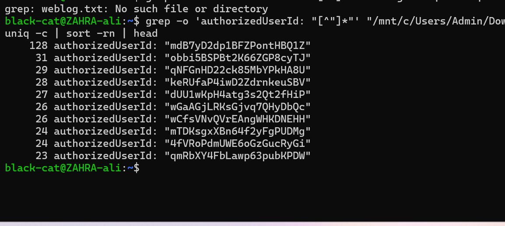
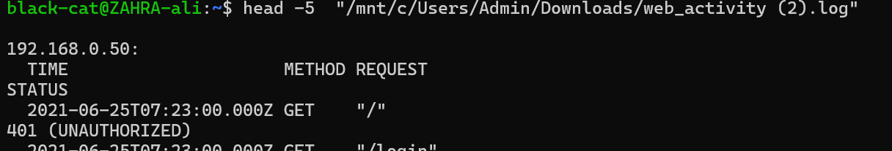
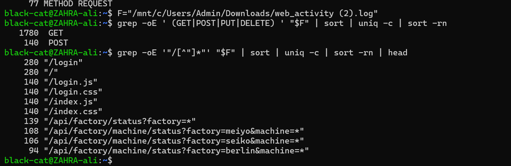
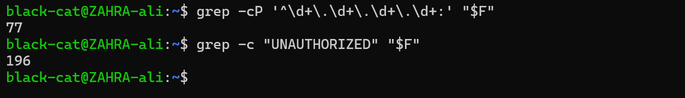
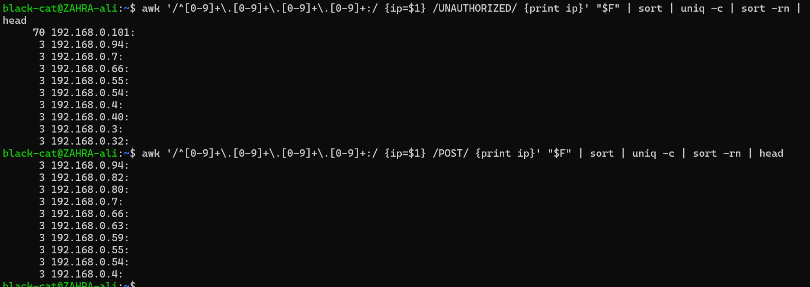
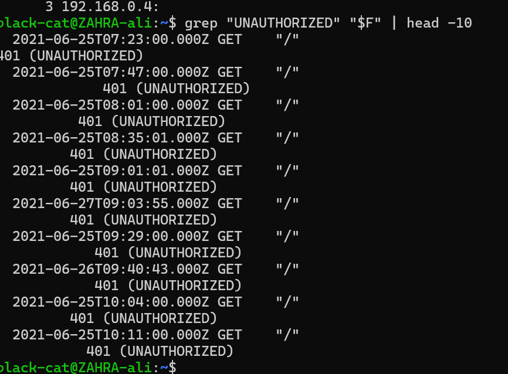
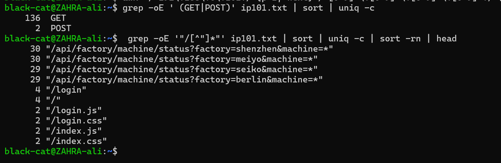
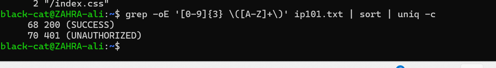
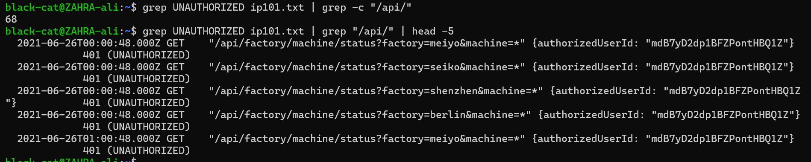
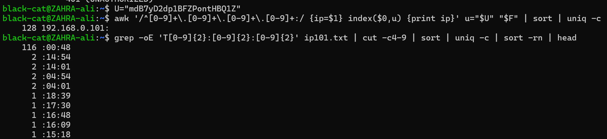

# Log Analysis: Deloitte Australia Cyber Job Simulation (Forage)

I did this task as part of the **Deloitte Australia Cyber virtual job simulation on Forage**. It is a **simulation**, so the client and the data are not real. The log file belongs to the program, so it is **not** in this repo. This repo has only my own commands, screenshots, and findings.

## Interview Summary

- **Scenario:** A client's production stopped and a news site published private information. The client suspected its new status board had been breached, and I had to check a web activity log.
- **Data:** A web activity log with 77 IP sections and about 1,920 requests.
- **Method:** Counted users, methods, paths, and refused requests with Ubuntu commands (`grep`, `awk`, `sort`, `uniq`).
- **Found:** One user ID made 128 requests (the next one made 31), and it was used by only one IP, `192.168.0.101`. That IP made about 118 requests for machine status data and was refused 70 times, while normal IPs were refused about 3 times. Most of its requests came at the same minute and second every hour.
- **Conclusion:** This is automated, not human-looking, and it is suspicious. It needs checking against the client's list of known devices.

## The Two Questions

1. **What is the most frequently used user ID?** `mdB7yD2dp1BFZPontHBQ1Z` (128 requests)
2. **Which IP address used it?** `192.168.0.101` (all 128 requests, and no other IP)

## How I Investigated

I stored the file path in a variable, so every command is shorter:
```
F="/mnt/c/Users/Admin/Downloads/web_activity (2).log"
```

**1. Who is most active?** One user ID made 128 requests. The next one made only 31.
```
grep -o 'authorizedUserId: "[^"]*"' "$F" | sort | uniq -c | sort -rn | head
```


**2. What does the log look like?** The file is split into sections. Each starts with an IP address, then a table of requests with time, method, request, and status.
```
head -5 "$F"
```


**3. What kinds of requests are there?** 1,780 GET and 140 POST (logins). The same login pattern repeats 140 times, so normal behavior has a clear rhythm.
```
grep -oE ' (GET|POST|PUT|DELETE) ' "$F" | sort | uniq -c | sort -rn
grep -oE '"/[^"]*"' "$F" | sort | uniq -c | sort -rn | head
```


**4. How many IPs, and how many refused requests?** 77 IP sections and 196 requests with `401 (UNAUTHORIZED)`.
```
grep -cP '^\d+\.\d+\.\d+\.\d+:' "$F"
grep -c "UNAUTHORIZED" "$F"
```


**5. Who got refused most?** The IP is only written at the top of each section, so I used `awk` to remember the last IP it saw and print it for each refused line. `192.168.0.101` was refused **70 times**. Every other IP was refused 3 times or fewer. Every IP made only 3 logins (POST).
```
awk '/^[0-9]+\.[0-9]+\.[0-9]+\.[0-9]+:/ {ip=$1} /UNAUTHORIZED/ {print ip}' "$F" | sort | uniq -c | sort -rn | head
awk '/^[0-9]+\.[0-9]+\.[0-9]+\.[0-9]+:/ {ip=$1} /POST/ {print ip}' "$F" | sort | uniq -c | sort -rn | head
```


**6. Are a few refused requests normal?** Yes. The first refused lines are `GET "/"` with 401: a user opens the page before logging in, and the server asks for a login. So a few 401s are normal. 70 is not.
```
grep "UNAUTHORIZED" "$F" | head -10
```


**7. Look at only one IP.** I wrote that section into its own file, then counted.
```
awk '/^192\.168\.0\.101:/ {p=1; next} /^[0-9]+\.[0-9]+\.[0-9]+\.[0-9]+:/ {p=0} p' "$F" > ip101.txt
grep -oE ' (GET|POST)' ip101.txt | sort | uniq -c
grep -oE '"/[^"]*"' ip101.txt | sort | uniq -c | sort -rn | head
```
It made 136 GET and 2 POST. About 118 of its requests asked for `/api/factory/machine/status?factory=...&machine=*` (the status of all machines in a factory), about 30 each for four factories: shenzhen, meiyo, seiko, and berlin. It visited the login page only a few times.



**8. How did the server answer it?** 68 successes (200) and 70 refusals (401).
```
grep -oE '[0-9]{3} \([A-Z]+\)' ip101.txt | sort | uniq -c
```


**9. What were the refused requests?** 68 of the 70 were API requests, and they carry the same user ID.
```
grep UNAUTHORIZED ip101.txt | grep -c "/api/"
grep UNAUTHORIZED ip101.txt | grep "/api/" | head -5
```


**10. Is the user ID on other IPs? Is there a pattern in the time?** The ID is on **only** this IP (128 lines). And **116 of the requests happen at the same minute and second (`:00:48`) every hour**, in groups of four (one for each factory).
```
U="mdB7yD2dp1BFZPontHBQ1Z"
awk '/^[0-9]+\.[0-9]+\.[0-9]+\.[0-9]+:/ {ip=$1} index($0,u) {print ip}' u="$U" "$F" | sort | uniq -c
grep -oE 'T[0-9]{2}:[0-9]{2}:[0-9]{2}' ip101.txt | cut -c4-9 | sort | uniq -c | sort -rn | head
```


## Findings

| Finding | Evidence |
|---|---|
| One user ID is far busier than the rest | 128 requests vs 31 for the next one |
| That ID belongs to one IP only | `192.168.0.101`, 128 lines |
| The IP asks for the same data again and again | About 30 requests for each of 4 factories |
| It is refused far more than normal | 70 refused vs 3 or fewer for others |
| It repeats on a clock | 116 requests at `:00:48`, every hour, 4 in the same second |

## Conclusion

The activity from `192.168.0.101` with user ID `mdB7yD2dp1BFZPontHBQ1Z` does not look like a person. It repeats every hour, on the second, and asks for the same status data for all four factories. It is **suspicious and needs follow-up**.

## Recommended Next Steps

1. Check whether `192.168.0.101` is a known, approved device in the client's records.
2. Find out who owns the user ID, and check whether the owner is aware of this activity.
3. Find out why requests that carry a user ID were still refused with 401. I do not know the reason from this log.
4. Consider disabling or resetting that account while it is checked.
5. Review what data the status board shows, to see what this activity could reach.

## Limits

- The log does not prove that data was stolen, or that this activity caused the production stop.
- The log shows only web requests, with no request bodies, so I cannot see the data that came back.
- The 401 results next to a valid-looking user ID are an open question.
- This is a simulation, so the result depends on the data provided.

## What I Learned

- Counting and sorting (`sort | uniq -c | sort -rn`) finds outliers fast.
- `awk` can remember a value (like an IP) from one line and use it on the lines after it.
- `grep -o`, `-E`, and `-P` change how patterns work (only the match, OR, and `\d`).
- Normal behavior has a rhythm, and what breaks it is worth a closer look.
- A good report says what the data shows, and what it does not.
